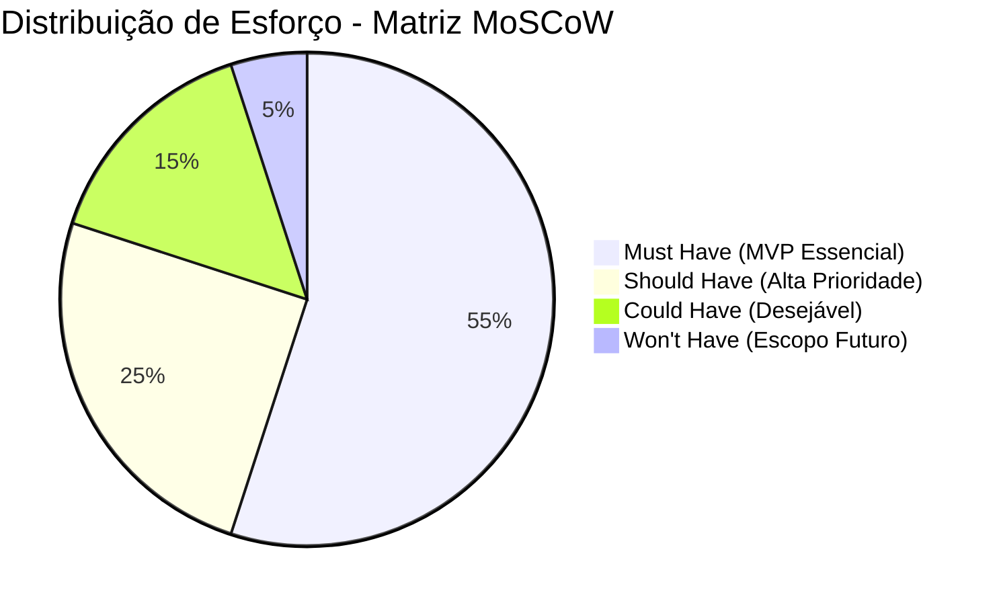

# DOCUMENTO DE ANÁLISE E ESPECIFICAÇÃO DE REQUISITOS (ERS)
**Projeto Multidisciplinar – Trilha Back-End**  
**Instituição:** Centro Universitário Internacional UNINTER  
**Cenário de Aplicação:** Rede de Lanchonetes "Raízes do Nordeste"  
**Versão do Documento:** 1.0  
**Data:** Fevereiro / 2026  

---

## 1. INTRODUÇÃO E CONTEXTUALIZAÇÃO DO NEGÓCIO

### 1.1 Contexto e Justificativa
A rede **"Raízes do Nordeste"** é uma rede de alimentação rápida (fast-casual) especializada na culinária regional nordestina (como cuscuz recheados, tapiocas gourmet, baião cremoso, cartola e sucos de frutas típicas). Em virtude do seu plano de expansão por franquias e quiosques em shopping centers e vias públicas, a rede enfrenta desafios críticos de centralização e interoperabilidade:
1. **Multicanalidade Desarticulada:** Os pedidos chegam por múltiplos canais — Aplicativo Móvel (`APP`), Totens de autoatendimento nas lojas (`TOTEM`), Atendimento de Balcão (`BALCAO`), Retirada Rápida agendada (`PICKUP`) e Portal Web (`WEB`).
2. **Descentralização de Estoques:** Embora o catálogo mestre de receitas e produtos seja centralizado pela franqueadora, o estoque de insumos e itens acabados pertence a cada unidade física de forma autônoma.
3. **Dependência e Gargalos em Meios de Pagamento:** A necessidade de desacoplar o ciclo do pedido do processamento financeiro externo, garantindo resiliência e conciliação assíncrona.
4. **Governança e Conformidade Legal:** Adequação estrita à Lei Geral de Proteção de Dados (LGPD - Lei nº 13.709/2018), tanto para a identificação de clientes quanto para os programas de fidelidade e trilhas de auditoria contábil e operacional.

### 1.2 Objetivo do Sistema
Projetar e homologar a especificação completa da **API RESTful do Back-End** da rede "Raízes do Nordeste", estabelecendo a camada de serviços necessária para unificar os canais de venda, garantir consistência transacional de estoque por unidade, gerenciar o ciclo de vida dos pedidos, auditar eventos críticos e prover integração desacoplada com gateway de pagamento simulado (Mock).

---

## 2. ATORES E PERFIS DE ACESSO (RBAC)

O sistema opera sob o modelo de **Controle de Acesso Baseado em Papéis** (*Role-Based Access Control* - RBAC). Os atores identificados são:

| Ator | Tipo | Perfil (*Role*) | Descrição das Atribuições |
|---|---|---|---|
| **Cliente** | Usuário Humano | `CLIENTE` | Realiza pedidos via App, Totem ou Web; consulta cardápio; efetua pagamento; consulta status de seus pedidos e saldo do programa de fidelidade. |
| **Atendente de Caixa** | Usuário Humano | `ATENDENTE` | Registra e consulta pedidos presenciais (`BALCAO` e `PICKUP`); auxilia clientes com dúvidas e solicita cancelamentos justificados. |
| **Operador de Cozinha** | Usuário Humano | `COZINHA` | Acessa o KDS (*Kitchen Display System*); visualiza a fila de pedidos com status `EM_PREPARO`; atualiza o status para `PRONTO`. |
| **Gerente / Administrador** | Usuário Humano | `ADMIN` | Gerencia unidades, cadastra produtos no catálogo central, monitora métricas, gerencia estoques das unidades e acessa os logs de auditoria. |
| **Gateway de Pagamento Mock** | Sistema Externo | `SERVICE_MOCK` | Serviço de simulação de autorização financeira (cartão, Pix e dinheiro); emite retorno de autorização, recusa ou falha de comunicação. |

---

## 3. ESCOPO DE MULTICANALIDADE

A multicanalidade é um requisito central do projeto. Qualquer transação de criação de pedido exige a identificação do canal de origem, obedecendo ao enumeration restrito:

```text
canalPedido = "APP" | "TOTEM" | "BALCAO" | "PICKUP" | "WEB"
```

### Particularidades Operacionais por Canal
- **TOTEM:** Operação rápida em loja; identificação do cliente pelo CPF é opcional; pagamento direto via cartão/Pix no terminal com necessidade de confirmação instantânea.
- **APP & WEB:** Exigem autenticação do cliente via JWT; cálculo de taxa de conveniência/entrega quando aplicável; acompanhamento de status em tempo real.
- **BALCAO:** Operado pelo `ATENDENTE`; aceita pagamento em dinheiro ou cartão; suporte a identificação rápida ou cliente anônimo.
- **PICKUP:** Modalidade com agendamento de retirada na loja física selecionada; separação de pedidos em baia de entrega prioritária.

---

## 4. REQUISITOS FUNCIONAIS (RF)

Abaixo estão detalhados os requisitos funcionais, com seus identificadores unívocos, entradas, saídas, regras de negócio associadas e critérios de aceitação no padrão estruturado (*Given-When-Then*).

---

### [RF01] Autenticação e Gestão de Usuários
- **Descrição:** O sistema deve permitir o cadastro de usuários e a emissão de tokens de autenticação seguros baseados no padrão JSON Web Token (JWT).
- **Ator Principal:** Qualquer usuário não autenticado ou Administrador.
- **Entrada de Dados:** Nome completo, e-mail único, senha (mínimo de 6 caracteres), telefone e aceite de termos LGPD (booleano).
- **Saída:** Código HTTP 201 Created (no registro) ou Código HTTP 200 OK contendo o token JWT (`Bearer <token>`), tempo de expiração e dados básicos do usuário (excluindo hash de senha).
- **Regras de Negócio Vinculadas:** RN01, RN02, RN09.
- **Critério de Aceite (BDD):**
  - **Dado** que um usuário forneça e-mail válido, senha forte e confirme o aceite LGPD;
  - **Quando** a requisição for processada pelo endpoint de login;
  - **Então** o sistema deve retornar o token JWT assinado com perfil de acesso correspondente.

---

### [RF02] Catálogo de Produtos e Gestão de Unidades
- **Descrição:** O sistema deve manter o cadastro central de unidades (lojas físicas) e o catálogo de produtos nordestinos, permitindo a consulta segmentada por unidade.
- **Ator Principal:** Todos os atores (leitura); Administrador (escrita).
- **Entrada de Dados:** `unidadeId` (parâmetro de rota) e filtros opcionais por categoria (Lanches, Refeições, Bebidas, Sobremesas).
- **Saída:** Lista de produtos disponíveis contendo: id, nome, descrição, categoria, preço unitário e disponibilidade de estoque na unidade consultada.
- **Regras de Negócio Vinculadas:** RN03.
- **Critério de Aceite (BDD):**
  - **Dado** que o cliente selecione a unidade "Matriz Recife";
  - **Quando** consultar o catálogo de produtos daquela unidade;
  - **Então** o sistema deve exibir apenas os produtos vinculados e com status ativo para a referida loja.

---

### [RF03] Criação de Pedido com Validação de Multicanalidade
- **Descrição:** O sistema deve permitir a abertura de novos pedidos, exigindo obrigatoriamente a especificação do canal de venda (`canalPedido`), a unidade responsável e a lista de itens desejados com quantidades.
- **Ator Principal:** Cliente e Atendente.
- **Entrada de Dados:**
  ```json
  {
    "unidadeId": "uuid-ou-id",
    "canalPedido": "TOTEM",
    "itens": [
      { "produtoId": "prod-01", "quantidade": 2 },
      { "produtoId": "prod-03", "quantidade": 1 }
    ],
    "observacoes": "Sem coentro no baião"
  }
  ```
- **Saída:** Código HTTP 201 Created contendo ID do pedido, valor total calculado, canal registrado e status inicial `AGUARDANDO_PAGAMENTO`.
- **Regras de Negócio Vinculadas:** RN04, RN05, RN06, RN07.
- **Critério de Aceite (BDD):**
  - **Dado** que uma requisição de pedido omitir ou informar um valor fora do enum no campo `canalPedido`;
  - **Quando** a API receber a requisição;
  - **Então** deve rejeitar a criação com código HTTP 400 Bad Request / 422 Unprocessable Entity, detalhando o campo inválido conforme padrão RFC 7807.

---

### [RF04] Validação e Reserva de Saldo de Estoque
- **Descrição:** Antes de confirmar a criação de qualquer pedido, o sistema deve validar atomicamente se a unidade selecionada possui saldo físico suficiente de cada item solicitado.
- **Ator Principal:** Sistema (Automático).
- **Entrada de Dados:** Lista de `(produtoId, quantidade)` e `unidadeId`.
- **Saída:** Confirmação de reserva de estoque ou recusa com erro 409 Conflict.
- **Regras de Negócio Vinculadas:** RN05, RN06.
- **Critério de Aceite (BDD):**
  - **Dado** que o produto "Cuscuz da Terra" possua 1 unidade em estoque na filial;
  - **Quando** um pedido for submetido solicitando 2 unidades;
  - **Então** o pedido não deve ser criado e o sistema deve retornar erro 409 informando que o saldo é insuficiente.

---

### [RF05] Integração e Processamento com Gateway Mock de Pagamento
- **Descrição:** O sistema deve disponibilizar um serviço mock desacoplado para simular o processamento de pagamentos em três cenários: Aprovação, Recusa e Falha de Conectividade.
- **Ator Principal:** Cliente, Atendente e Serviço de Mock.
- **Entrada de Dados:** `pedidoId`, forma de pagamento (`PIX`, `CARTAO_CREDITO`, `CARTAO_DEBITO`, `DINHEIRO`) e parâmetro simulado (ex.: `statusSimulado: "APROVADO"` ou payload com valor).
- **Saída:** Transação financeira registrada com comprovante e novo status do pedido atualizado para `EM_PREPARO` (em caso de sucesso) ou mantido em `AGUARDANDO_PAGAMENTO` (em caso de recusa).
- **Regras de Negócio Vinculadas:** RN07, RN08.
- **Critério de Aceite (BDD):**
  - **Dado** que um pedido esteja em status `AGUARDANDO_PAGAMENTO`;
  - **Quando** a rota de pagamento receber um comando de simulação de aprovação;
  - **Então** a transação de pagamento deve ser persistida com status `SUCESSO` e o pedido deve transicionar imediatamente para `EM_PREPARO`.

---

### [RF06] Gestão do Ciclo de Vida do Pedido e KDS (Cozinha)
- **Descrição:** O sistema deve controlar a máquina de estados finitos do pedido, permitindo que a cozinha e atendentes transitem o pedido através das etapas de preparo, conclusão e entrega.
- **Ator Principal:** Operador de Cozinha e Atendente de Caixa.
- **Entrada de Dados:** `pedidoId` e `novoStatus` (`EM_PREPARO`, `PRONTO`, `ENTREGUE`, `CANCELADO`).
- **Saída:** Pedido atualizado e timestamp da alteração de estado.
- **Regras de Negócio Vinculadas:** RN07.
- **Critério de Aceite (BDD):**
  - **Dado** que um pedido esteja no estado `EM_PREPARO`;
  - **Quando** o operador da cozinha registrar o término do preparo;
  - **Então** o status do pedido deve mudar para `PRONTO` e ficar disponível para retirada/entrega.

---

### [RF07] Programa de Fidelidade com Consentimento Explícito
- **Descrição:** O sistema deve calcular e acumular pontos de fidelidade para clientes cadastrados (1 ponto a cada R$ 10,00 gastos), condicionado à manifestação de consentimento específico.
- **Ator Principal:** Cliente.
- **Entrada de Dados:** Identificador do cliente ou CPF no momento do pedido e consentimento ativo (`consentimentoFidelidade: true`).
- **Saída:** Saldo acumulado atualizado e histórico de créditos de pontos.
- **Regras de Negócio Vinculadas:** RN09, RN10.
- **Critério de Aceite (BDD):**
  - **Dado** que um cliente realizou um pedido de R$ 50,00 e possui consentimento LGPD concedido;
  - **Quando** o pagamento for confirmado com sucesso;
  - **Então** o sistema deve creditar 5 pontos na carteira de fidelidade do cliente.

---

### [RF08] Trilha de Auditoria Transacional
- **Descrição:** O sistema deve gravar de forma indelével eventos críticos de alteração de estado e financeiro para conformidade contábil e segurança cibernética.
- **Ator Principal:** Sistema (Automático).
- **Entrada de Dados:** `usuarioId` (ou sistema), `acao` executada, `recurso`, `payloadResumido`, endereço IP e data/hora UTC.
- **Saída:** Registro inserido na tabela `audit_logs`.
- **Regras de Negócio Vinculadas:** RN11.
- **Critério de Aceite (BDD):**
  - **Dado** que qualquer usuário altere o status de um pedido ou confirme um pagamento;
  - **Quando** a transação for concluída com sucesso no banco de dados;
  - **Então** um registro de auditoria deve ser criado automaticamente com carimbo temporal e autor da ação.

---

## 5. REQUISITOS NÃO FUNCIONAIS (RNF)

Os Requisitos Não Funcionais estabelecem as qualidades sistêmicas, métricas operacionais e restrições arquiteturais exigidas para a solução.

| ID | Categoria | Descrição do Requisito | Métrica / Critério de Verificação |
|---|---|---|---|
| **RNF01** | **Segurança & Criptografia** | As senhas dos usuários nunca devem ser armazenadas em texto plano. Deve-se empregar o algoritmo **Bcrypt** com fator de custo (*salt rounds*) igual a 10. | Inspeção do schema do banco e testes unitários de hash/comparação. |
| **RNF02** | **Autenticação & RBAC** | Todas as rotas de negócio (exceto login, cadastro público e documentação) devem exigir token **JWT** no cabeçalho `Authorization: Bearer <token>`, com validação de perfis (*roles*). | Testes de retorno HTTP 401 (sem token) e HTTP 403 (perfil não autorizado). |
| **RNF03** | **Privacidade & LGPD** | Aplicação do princípio da minimização de dados (Art. 6º, III da Lei 13.709/2018). Dados sensíveis e senhas não devem ser expostos em respostas JSON. Dados de fidelidade exigem base legal de consentimento explícito (Art. 7º, I). | Auditoria de payloads de resposta de APIs e verificação do campo de consentimento. |
| **RNF04** | **Padronização REST & Erros** | As respostas de erro da API devem seguir estritamente o padrão estendido da **RFC 7807** (*Problem Details for HTTP APIs*), contendo código de erro unificado, mensagem clara e lista de inconsistências por campo. | Verificação do formato JSON retornado nos status codes 400, 401, 403, 404, 409 e 500. |
| **RNF05** | **Documentação OpenAPI / Swagger** | A API deve expor documentação interativa completa e acessível pela rota `/api-docs` utilizando a especificação **OpenAPI 3.0** via Swagger UI. | Acesso visual via navegador à rota `/api-docs` com execução de chamadas *try-it-out*. |
| **RNF06** | **Desempenho & Concorrência** | As validações de estoque e criação de pedido devem ser executadas em transação atômica do banco de dados (ACID) para evitar condições de corrida (*race conditions* / overselling). | Tempo de resposta de criação de pedidos inferior a 300 ms em carga normal. |
| **RNF07** | **Portabilidade & Execução (Avaliador)** | A aplicação deve utilizar **Node.js (ES Modules)** com **Prisma ORM** e banco embarcado **SQLite**, permitindo execução imediata pelo tutor da UNINTER via comandos `npm install`, `npm run setup` e `npm start` sem necessidade de bancos externos ou Docker. | Validação de inicialização limpa em ambiente isolado em menos de 2 minutos. |

---

## 6. REGRAS DE NEGÓCIO INVARIANTES (RN)

As regras de negócio a seguir descrevem as premissas e restrições mandatórias do domínio:

- **RN01 - Unicidade de Identificação:** Não é permitido o cadastro de dois usuários com o mesmo endereço de e-mail.
- **RN02 - Validade do Token de Acesso:** O token JWT emitido possui prazo de validade de 8 horas, findo o qual uma nova autenticação é exigida.
- **RN03 - Escopo de Estoque por Filial:** Um produto pode possuir preços idênticos na rede, mas seu saldo de estoque é rigorosamente isolado por `unidadeId`.
- **RN04 - Obrigatoriedade do Canal de Venda:** A propriedade `canalPedido` é obrigatória na criação do pedido e não pode ser nula ou modificada após a criação.
- **RN05 - Atomicidade na Baixa de Estoque:** Ao criar o pedido e confirmar o pagamento, a baixa dos itens do estoque daquela unidade deve ocorrer de maneira transacional. Se algum item falhar, toda a operação sofre reversão (*rollback*).
- **RN06 - Proibição de Estoque Negativo:** O saldo disponível de um item em estoque jamais pode ser menor que zero. Caso a quantidade solicitada exceda o saldo, a transação deve ser bloqueada.
- **RN07 - Máquina de Estados do Pedido:** O ciclo de transição de status deve obedecer à seguinte sequência válida e irreversível:
  $$\text{AGUARDANDO\_PAGAMENTO} \longrightarrow \text{EM\_PREPARO} \longrightarrow \text{PRONTO} \longrightarrow \text{ENTREGUE}$$
  - O cancelamento (`CANCELADO`) só é admitido a partir dos estados `AGUARDANDO_PAGAMENTO` ou `EM_PREPARO`.
  - Pedidos no status `PRONTO` ou `ENTREGUE` não podem sofrer cancelamento automático.
- **RN08 - Timeout de Pagamento Mock:** Pedidos que permaneçam no status `AGUARDANDO_PAGAMENTO` por mais de 30 minutos são elegíveis para cancelamento automático por expiração e liberação de reserva.
- **RN09 - Consentimento e Base Legal LGPD:** A coleta de CPF para o programa de fidelidade exige termo de consentimento explícito (Art. 7º, I da LGPD). Caso o cliente não consinta, a compra é processada normalmente sem atribuição de pontos.
- **RN10 - Regra de Bonificação de Fidelidade:** A proporção de bonificação é de 1 ponto a cada R$ 10,00 efetivamente pagos (valores fracionários são truncados).
- **RN11 - Imutabilidade dos Logs de Auditoria:** Os registros de auditoria em `audit_logs` são somente-leitura (*append-only*); nenhum usuário, inclusive o `ADMIN`, possui permissão de `UPDATE` ou `DELETE` nessa tabela via API.

---

## 7. MATRIZ DE PRIORIZAÇÃO DE REQUISITOS (MoSCoW)

A priorização orienta a fronteira entre o que é implementado de forma plenamente funcional no **MVP da API** (garantindo nota máxima nos critérios de código e execução da UNINTER) e o que compõe a **visão de expansão futura**:



| Classificação MoSCoW | Identificador | Requisito / Funcionalidade | Escopo | Justificativa Técnica |
|---|---|---|---|---|
| **MUST HAVE** (Indispensável) | RF01, RNF01, RNF02 | Autenticação JWT, Bcrypt e RBAC de usuários | **MVP** | Base de segurança obrigatória para controle de acesso e auditoria. |
| **MUST HAVE** (Indispensável) | RF02 | Listagem de unidades e catálogo de produtos por loja | **MVP** | Requisito estrutural de navegação e seleção da filial de compra. |
| **MUST HAVE** (Indispensável) | RF03 | Criação de pedido com validação de `canalPedido` | **MVP** | Critério avaliativo central da Uninter (multicanalidade explícita). |
| **MUST HAVE** (Indispensável) | RF04, RNF06 | Validação e reserva atômica de estoque por unidade | **MVP** | Garante consistência de dados e impede overselling de produtos. |
| **MUST HAVE** (Indispensável) | RF05 | Mock de pagamento com simulação de sucesso e recusa | **MVP** | Exigência explícita do edital para o fluxo crítico desacoplado. |
| **MUST HAVE** (Indispensável) | RF06 | Gestão de ciclo de vida do pedido (Cozinha / KDS) | **MVP** | Permite transição controlada de estados (`EM_PREPARO`, `PRONTO`). |
| **MUST HAVE** (Indispensável) | RNF04, RNF05 | Swagger OpenAPI 3.0 e Tratamento de Erros RFC 7807 | **MVP** | Facilita a validação imediata pelo professor e padroniza os retornos. |
| **SHOULD HAVE** (Deveria Conter) | RF08, RNF03 | Registro de Logs de Auditoria e Adequação LGPD | **MVP** | Atende diretamente ao bloco de Governança e Segurança do edital. |
| **SHOULD HAVE** (Deveria Conter) | RF07 | Gestão de Fidelidade com Termo de Consentimento | **MVP** | Exemplifica de forma concreta a aplicação do Art. 7º da LGPD. |
| **COULD HAVE** (Poderia Conter) | Extra Front | Interface Web interativa demonstrativa (`/public`) | **MVP** | Permite que o tutor clique e veja o sistema funcionando sem Postman. |
| **WON'T HAVE** (Escopo Futuro) | Expansão | Integração real com adquirentes (Cielo/Stone/Stripe) | Futuro | Substituído com propriedade pelo serviço mock desacoplado. |
| **WON'T HAVE** (Escopo Futuro) | Expansão | Rastreamento GPS de entregadores em mapa | Futuro | Fora do escopo do back-end para pedidos balcão, totem e pickup. |
| **WON'T HAVE** (Escopo Futuro) | Expansão | Emissão de cupom fiscal eletrônico (NFC-e / SEFAZ) | Futuro | Depende de certificado digital A1 e homologação fiscal estadual. |

---

## 8. MATRIZ DE RASTREABILIDADE DE REQUISITOS

Esta matriz correlaciona cada Requisito Funcional com os Endpoints REST do projeto, Atores e os Critérios da Tabela de Avaliação da UNINTER:

| Requisito | Atores Impactados | Endpoint(s) REST Associado(s) | Método | Critério UNINTER Atendido |
|---|---|---|---|---|
| **RF01** | Todos | `/api/v1/auth/register`<br>`/api/v1/auth/login` | POST<br>POST | Critério 3 (Implementação API) & Critério 4 (Segurança) |
| **RF02** | Cliente, Atendente, Admin | `/api/v1/unidades`<br>`/api/v1/unidades/{id}/produtos` | GET<br>GET | Critério 2 (Modelagem) & Critério 3 (Implementação) |
| **RF03** | Cliente, Atendente | `/api/v1/pedidos` | POST | Critério 1 (Multicanalidade) & Critério 3 (API) |
| **RF04** | Sistema | `/api/v1/pedidos` (Verificação interna) | POST | Critério 1 (Estoque) & Critério 3 (Regras de Negócio) |
| **RF05** | Cliente, Caixa, Mock | `/api/v1/pedidos/{id}/pagamento` | POST | Critério 1 (Fluxo A - Mock) & Critério 3 (Integração) |
| **RF06** | Cozinha, Atendente | `/api/v1/pedidos/{id}/status`<br>`/api/v1/pedidos` | PATCH<br>GET | Critério 1 (Ciclo do Pedido) & Critério 3 (KDS) |
| **RF07** | Cliente | `/api/v1/fidelidade/extrato`<br>`/api/v1/fidelidade/consentimento` | GET<br>POST | Critério 4 (LGPD e Consentimento) |
| **RF08** | Sistema, Admin | `/api/v1/auditoria` | GET | Critério 4 (Auditoria e Rastreabilidade) |
| **RNF04** | Todos | Todos os endpoints com formato RFC 7807 | Todos | Critério 3 (Qualidade de Código e Erros) |
| **RNF05** | Avaliador, Desenvolvedor | `/api-docs` | GET | Critério 6 (Documentação Técnica e Swagger) |

---

## 9. DECLARAÇÃO DE CONFORMIDADE E CONSIDERAÇÕES FINAIS

O presente documento de análise de requisitos foi formulado para garantir conformidade integral com as exigências do **Roteiro Prático de Projeto de Back-End da UNINTER**. 

Ao delimitar formalmente as fronteiras de multicanalidade (`canalPedido`), consistência de estoque por filial, desacoplamento do gateway financeiro através de mock, garantias de segurança baseadas em JWT/RBAC e salvaguardas da LGPD, este documento serve como alicerce mandatório para a **Etapa 2 (Modelagem e Arquitetura)** e subsequente implementação de código na **Etapa 3**.
